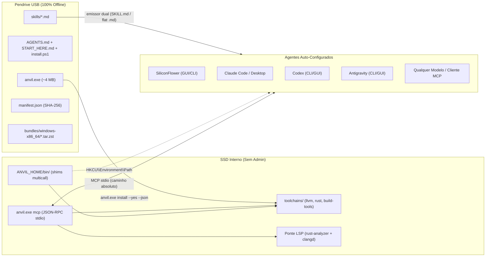

# ⚒️ Anvil

[](https://github.com/1155dosilicon/anvil-ai/actions/workflows/ci.yml)
[](LICENSE)
[](#escopo)
[](Cargo.toml)

**Canivete suíço portátil e 100% offline em USB para agentes de IA no Windows x86_64.**

Sempre que você reinstala o Windows, perde horas baixando e configurando Visual Studio Build Tools, compiladores C/C++, Rust, LLVM/Clang, CMake, Ninja, servidores LSP (`clangd`, `rust-analyzer`), servidores MCP e Skills de programação. O **Anvil** resolve isso em **um único binário nativo** (`anvil.exe`, ~4 MB, zero dependências) pensado para que **qualquer agente de IA — inclusive modelos abertos menores — plugue o pendrive, instale, valide e já saia programando**.

---

## 🎯 Escopo

### O que o Anvil faz
- **Pendrive mínimo + instalação rápida no SSD interno (sem admin):** em vez de carregar 50.000 arquivos soltos num pendrive lento (5 MB/s), os toolchains ficam compactados em pacotes `.tar.zst` lidos em **uma única passada sequencial com verificação SHA-256 on-the-fly** direto para o SSD do PC (`%LOCALAPPDATA%\anvil` por padrão, ou `ANVIL_HOME` / `--dest`).
- **Zero Visual Studio Build Tools:**
  - **C / C++:** `llvm-mingw` (UCRT x86_64 com Clang 20, `libc++`, `ld.lld`, `lldb`, `clangd`, `clang-tidy`, `clang-format`, `llvm-ar`, `llvm-windres`/`windres`, `llvm-objdump`, `llvm-nm`, `llvm-strip`). Executáveis C++ standalone usam `-static` (padrão automático no MCP `cc_build`, tanto para arquivo único quanto para diretórios de build CMake novos, exceto com sanitizers ou `BUILD_SHARED_LIBS=ON`) para rodar em qualquer PC Windows sem `libc++.dll`/`libunwind.dll`.
  - **Rust:** toolchain host `x86_64-pc-windows-gnu` com bibliotecas MinGW **self-contained** (`-C link-self-contained=yes`), gerando `.exe` 100% standalone (zero DLLs extras) e compatível com build scripts em C (`CC=clang.exe`), além do `rust-std` opcional para `x86_64-pc-windows-gnullvm` linkando via `llvm-mingw`/`lld` — também standalone, pois o Anvil define `CARGO_TARGET_X86_64_PC_WINDOWS_GNULLVM_RUSTFLAGS=-C target-feature=+crt-static` (a menos que você já tenha definido essa variável).
  - **Build tools:** CMake, CTest e Ninja.
- **Shims multicall isolados:** um único `anvil.exe` em `ANVIL_HOME\bin\` vinculado via NTFS hard links (`clang`, `clang++`, `clangd`, `clang-tidy`, `clang-format`, `ld.lld`, `lldb`, `llvm-ar`, `llvm-ranlib`, `llvm-windres`, `windres`, `llvm-objdump`, `llvm-nm`, `llvm-strip`, `rustc`, `cargo`, `rustfmt`, `clippy-driver`, `cargo-clippy`, `rust-analyzer`, `rustdoc`, `cmake`, `ctest`, `ninja`) que injeta automaticamente `PATH`, `CC`, `CXX`, `RUSTC`, `RUST_SRC_PATH`, `CARGO_HOME`, `CMAKE_GENERATOR=Ninja` e as variáveis de linkagem do Cargo — inclusive para **apps GUI** via `HKCU\Environment`.
- **Auto-configuração segura de agentes (CLI + GUI):** registra o MCP `anvil mcp` com caminho absoluto e sincroniza as skills no formato nativo de cada agente, preservando chaves, outros MCPs e comentários, com backup automático antes de editar.
- **Servidor MCP unificado com Ponte LSP embutida (`anvil mcp`):** expõe 11 tools enxutas em JSON-RPC 2.0 sobre `stdio` (compilação estruturada, diagnósticos, hover, go-to-definition, referências, símbolos e leitura de skills) — assim até modelos pequenos que não dominam LSP bruto usam `clangd` e `rust-analyzer` facilmente.
- **Smoke-test à prova de DLL faltando:** `anvil doctor --smoke-test` compila C, C++ (`-static`), Rust e Rust `gnullvm` e executa cada `.exe` com um `PATH` mínimo do Windows (`%SystemRoot%\System32;%SystemRoot%`), detectando imediatamente regressões de DLL.
- **Modo offline + atualizador sob demanda (`anvil bundle sync`):** monta ou atualiza o pendrive quando houver internet e valida toda a integridade com `anvil bundle verify`.

### O que NÃO entra neste repositório
- **Nenhum binário de terceiros é hospedado neste Git.** O repositório contém apenas o código-fonte Rust do Anvil, as skills em Markdown, os templates do USB e a receita JSON com links para os releases oficiais upstream.
- Não substitui gerenciadores de pacotes para bibliotecas gráficas/SO arbitrárias; o foco é a stack nativa **C, C++, LLVM/Clang, Rust, CMake, CTest, Ninja, LLDB, LSPs, MCP e Skills**.
- Plataforma suportada: **Windows 10/11 x86_64**.

---

## 🏗️ Arquitetura



### Estrutura do Workspace Rust

```text
crates/
├── anvil-core/     # Manifest, State, Platform (Windows x86_64), Paths, EnvMode sandbox, extrator streaming .tar.zst + SHA-256
├── anvil-env/      # Dispatch multicall, shims NTFS, HKCU\Environment, anvil env (PowerShell/JSON), doctor + smoke-tests
├── anvil-agents/   # Adaptadores SiliconFlower, Claude, Codex e Antigravity + emissor dual de skills + templates USB
├── anvil-lsp/      # Cliente LSP (Content-Length JSON-RPC) com pool lazy para rust-analyzer e clangd (1-based)
├── anvil-mcp/      # Servidor MCP stdio com wrappers estruturados Cargo/Clang/CMake e ponte LSP
├── anvil-bundle/   # Construtor de pendrive (init-usb, pack, sync com receitas JSON, verify SHA-256)
└── anvil-cli/      # Binário único `anvil.exe` integrando dispatch multicall e todos os subcomandos
skills/             # 5 skills canônicas em Markdown (embutidas no binário via include_str!)
templates/          # AGENTS.md, START_HERE.md, install.ps1 para a raiz do USB
```

---

## 🤖 Agentes Suportados

| Agente | Config MCP (caminho absoluto) | Skills | Notas |
| :--- | :--- | :--- | :--- |
| **SiliconFlower** (GUI + CLI) | `%USERPROFILE%\.siliconflower\config.json` (ou `$SILICONFLOWER_DATA_DIR\config.json`) | Flat `.md` em `%USERPROFILE%\.siliconflower\skills\<nome>.md` | Preserva `apiKey`, `baseURL`, `hooks` e outros MCPs; caminho absoluto garante funcionamento no app Electron. |
| **Claude Code / Desktop** | `%USERPROFILE%\.claude.json` + `%APPDATA%\Claude\claude_desktop_config.json` | Pasta em `%USERPROFILE%\.claude\skills\<nome>\SKILL.md` | Desktop só é tocado se já existir (ou com `--all`). |
| **Codex** (CLI + GUI) | `%USERPROFILE%\.codex\config.toml` (`[mcp_servers.anvil]`) | Pasta em `%USERPROFILE%\.codex\skills\<nome>\SKILL.md` (+ `%USERPROFILE%\.agents\skills\` se existir) | Edição via `toml_edit` preservando comentários e formatação. |
| **Antigravity** (CLI + GUI) | `%USERPROFILE%\.gemini\antigravity\mcp_config.json` | Pasta em `%USERPROFILE%\.gemini\antigravity\skills\<nome>\SKILL.md` (+ `%USERPROFILE%\.gemini\config\skills\`) | Compatível com descoberta nativa de skills. |
| **Qualquer outro cliente / modelo aberto** | `anvil agents print-config --format json\|toml` | `anvil skills list/read` ou tools MCP `skill_list`/`skill_read` | Basta ler `AGENTS.md` na raiz do USB. |

> **Segurança:** toda modificação em config existente gera backup automático em `ANVIL_HOME\backups\`. Skills gravadas pelo Anvil carregam um marcador gerenciado; skills escritas por você nunca são sobrescritas nem apagadas no `uninstall`.

---

## 🧰 Servidor MCP Unificado (`anvil mcp`)

Todos os números de linha e coluna são **1-based** (como em compiladores e editores) para evitar erros off-by-one em LLMs.

| Tool | Descrição |
| :--- | :--- |
| `anvil_doctor` | Verifica toolchains, versões, agentes e (opcional) compila/executa smoke-tests em C, C++ standalone e Rust sob `PATH` limpo. |
| `rust_cargo` | Roda `check`, `build`, `test`, `clippy`, `fmt_check` ou `fmt` com diagnósticos JSON estruturados (`file`, `line`, `col`, `code`, `message`). |
| `cc_build` | Configura e compila C/C++ com CMake + Ninja (gerando `compile_commands.json` para o `clangd`) ou compila arquivo único direto com Clang (C++ usa `-static` por padrão sem sanitizers; configurável via `static_link`). |
| `cc_lint_format` | Roda `clang-format` ou `clang-tidy` em modo `check` ou `fix`. |
| `lsp_diagnostics` | Diagnósticos em tempo real via `rust-analyzer` ou `clangd`. |
| `lsp_hover` | Tipo, assinatura e documentação em `(file, line, col)`. |
| `lsp_definition` | Ir para definição em `(file, line, col)`. |
| `lsp_references` | Listar referências do símbolo em `(file, line, col)`. |
| `lsp_symbols` | Listar símbolos do arquivo (`file`) ou buscar no workspace (`query`). |
| `skill_list` | Lista as 5 skills embutidas. |
| `skill_read` | Lê o conteúdo completo de uma skill (`anvil-toolkit`, `rust-systems`, `c-modern`, `cpp-modern`, `cmake-ninja-debug`). |

---

## 🚀 Uso Rápido

### 1. Montar ou atualizar o pendrive (PC com internet)

```powershell
# Compilar o binário release
cargo build --release --bin anvil

# Inicializar a raiz do pendrive (copia AGENTS.md, START_HERE.md, install.ps1, skills e anvil.exe)
.\target\release\anvil.exe bundle init-usb --usb E:\anvil --win-exe .\target\release\anvil.exe

# Conferir o plano de download dos toolchains oficiais (dry-run)
.\target\release\anvil.exe bundle sync --usb E:\anvil --dry-run

# Baixar e empacotar tudo em .tar.zst no pendrive (resumível com cache local)
.\target\release\anvil.exe bundle sync --usb E:\anvil

# Validar SHA-256, tamanhos e arquivos do pendrive inteiro
.\target\release\anvil.exe bundle verify --usb E:\anvil --json
```

> **Dicas:**
> - **Pendrive montado com o Anvil 0.1 (Windows + Linux)?** Rode `anvil.exe bundle init-usb --usb E:\anvil` com o binário novo: ele remove `install.sh`, o binário Linux `anvil`, `bundles\linux-x86_64\` e as entradas Linux do `manifest.json` (o `install`/`verify` já ignoram essas entradas com um aviso).
> - Para personalizar versões/URLs sem recompilar, exporte a receita padrão com `anvil bundle print-recipe > recipe.json`, edite e passe `--recipe recipe.json`.
> - Para empacotar manualmente qualquer pasta de toolchain local: `anvil bundle pack --usb E:\anvil --id llvm --version 20.1 --source C:\caminho\llvm`.

### 2. Instalar em um PC Windows recém-formatado (100% offline)

```powershell
.\anvil.exe install --yes --json
& "$env:LOCALAPPDATA\anvil\bin\anvil.exe" doctor --smoke-test --json
```

Ou dê clique direito em `install.ps1` → **Executar com PowerShell**.
Qualquer agente de IA que abrir a pasta do pendrive e ler [AGENTS.md](templates/AGENTS.md) executa exatamente esse fluxo sozinho.

---

## 💻 Referência da CLI

```text
anvil install         Instala bundles .tar.zst em streaming, cria shims, configura PATH e agentes
anvil doctor          Verifica instalação, versões, agentes e (--smoke-test) compila/roda C, C++ e Rust
anvil env             Imprime comandos PowerShell (ou JSON) para a sessão atual
anvil agents          detect | setup | remove | print-config
anvil skills          list | read <nome> | sync
anvil mcp             Sobe o servidor MCP unificado sobre stdio (toolchains + ponte LSP + skills)
anvil bundle          init-usb | pack | sync | verify | print-recipe
anvil uninstall       Remove instalação, shims, PATH e entradas do Anvil nos agentes
```

Todos os comandos de automação aceitam `--json` (stdout sempre contém **exatamente um documento JSON**; progresso e avisos vão para `stderr`).

---

## 🧪 Desenvolvimento e CI

```powershell
cargo fmt --check
cargo clippy --workspace --all-targets -- -D warnings
cargo test --workspace
cargo build --release --bin anvil
```

Os testes nunca alteram o Registry do Windows nem o `%USERPROFILE%` real — toda a suíte roda isolada via `ANVIL_ENV_SANDBOX`.
O workflow [.github/workflows/ci.yml](.github/workflows/ci.yml) compila, testa e publica `anvil-windows-x86_64.exe` a cada push/PR/tag.

---

## 📄 Licença e Componentes de Terceiros

O código-fonte do **Anvil** é distribuído sob a licença **[MIT](LICENSE)**.

Os toolchains baixados localmente pelo comando `anvil bundle sync` pertencem aos seus respectivos projetos upstream e usam licenças open-source permissivas:

| Componente Upstream | Licença |
| :--- | :--- |
| LLVM / Clang / clangd / lld / lldb | Apache-2.0 WITH LLVM-exception |
| llvm-mingw | ISC / Permissive |
| Rust / Cargo / Clippy / rustfmt / rust-analyzer | MIT OR Apache-2.0 |
| CMake / CTest | BSD-3-Clause |
| Ninja | Apache-2.0 |
